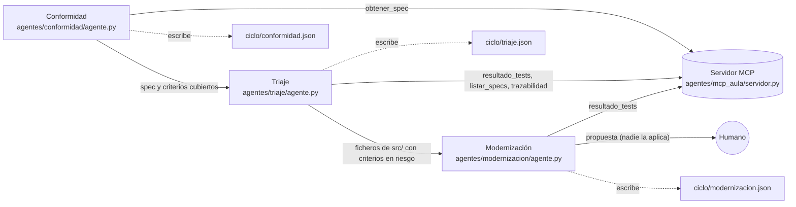

# Flotilla de Aula

Tres agentes deterministas sobre el mismo servidor MCP. El contrato validable está en
`agentes/flotilla/contrato.json`; este fichero lo dibuja.

## Handoff

| De | A | Qué se pasa |
|----|---|-------------|
| Conformidad | Triaje | La spec y los criterios que el PR cubre, para comprobar que sus tests pasan |
| Triaje | Modernización | Los ficheros de `src/` de la spec cuyos criterios están en riesgo |
| Modernización | Humano | La propuesta de mejora; ningún agente la aplica |

Cada agente solo lee del servidor MCP y escribe solo en su fichero de `ciclo/`.

## Conflicto

- **Prevención:** ningún agente modifica `src/`, `tests/` ni `specs/`, y cada uno escribe solo
  en su propio fichero de salida, así que no pueden pisarse.
- **Si dos señalan el mismo fichero:** no se aplica ningún cambio y decide el humano.
